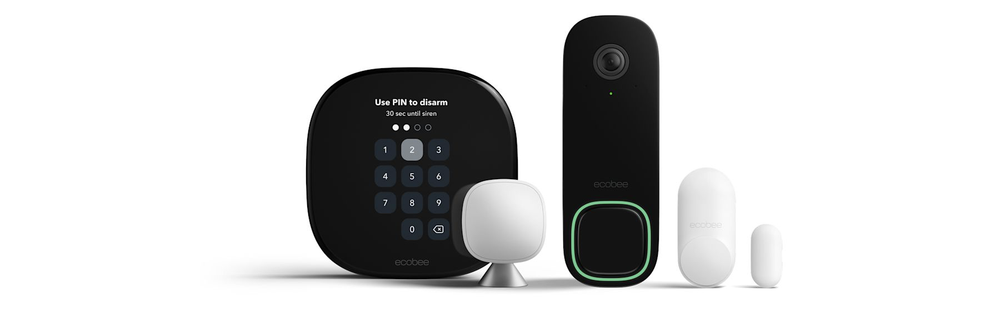

<p align="center"></p>

# homebridge-ecobee-security

<p align="center"><b>ecobee Smart Security</b> for Apple Home</p>

<p align="center">
  <a href="https://www.npmjs.com/package/homebridge-ecobee-security"></a>
  <a href="https://www.npmjs.com/package/homebridge-ecobee-security"></a>
  <a href="LICENSE"></a>
</p>

Shows **ecobee Smart Security** in Apple Home as a security system: set it to **Home**, **Away** or
**Off** (ecobee's Stay, Away and disarmed), and see **Alarm triggered** when ecobee has an open
intrusion or smoke incident. It works with Siri ("set the security system to away") and Home
automations. ecobee removed Smart Security from its HomeKit integration; this brings it back, and adds
air quality sensors, a keypad disarm, presence and vacation switches, security holds for other plugins
and the ecobee doorbell camera with HomeKit Secure Video.

<p align="center"></p>

Unofficial. It uses the same cloud API as the ecobee iOS app (Auth0 sign-in at `auth.ecobee.com`,
GraphQL at `federated-api.prod.federated-graph.generacapis.com`), which ecobee can change at any time.

> [!WARNING]
> Not affiliated with or endorsed by ecobee. The plugin signs in as the ecobee iOS app, which
> ecobee may not allow, and it can stop working whenever ecobee changes its app or API.
> If you have **professional monitoring**, testing an alarm (opening a door while armed) can
> lead to a call from the monitoring centre or a dispatch, just as it would with the ecobee app.

## Features

- **Security system** with Home, Away, Night (optional) and Off, exit delay, and Alarm triggered.
- **Smoke Alarm** sensor for automations and Home app smoke notifications.
- **Air quality** and **CO2** sensors for ecobee thermostats that have one (ecobee Premium).
- **Keypad unlock** turns the system off when a door is unlocked with a code on its keypad.
- **Home Occupied** switch (with occupancy sensor) for arrive and leave automations without confirmation prompts.
- **Vacation Mode** switch that follows, and starts, an ecobee vacation.
- **Security holds** let other plugins, like a robot vacuum, keep the system from arming Away while they work.
- **Doorbell camera** with HomeKit Secure Video, live view and snapshots; with the **doorbell link**, instant ring and motion, the sensors the doorbell bridges to HomeKit, and its Chime, Status Light and Night Vision switches.

## Contents

- [Requirements](#requirements)
- [Install](#install)
- [Sign-in](#sign-in)
- [Settings](#settings)
- [Security system](#security-system)
- [Keypad unlock](#keypad-unlock)
- [Security holds](#security-holds)
- [Doorbell camera](#doorbell-camera)
- [Home Occupied switch](#home-occupied-switch)
- [Vacation Mode switch](#vacation-mode-switch)
- [Smoke alarm and air quality](#smoke-alarm-and-air-quality)
- [Troubleshooting](#troubleshooting)
- [API notes](#api-notes)
- [License](#license)

## Requirements

- Homebridge 1.8 or 2.x and Node 22 or 24.
- An ecobee account with **Smart Security** (the ecobee Smart Doorbell Camera is only needed for the doorbell features).
- For the doorbell camera: an ffmpeg with `libfdk_aac` and `libx264` (the Homebridge Raspberry Pi image has one), and, for HomeKit Secure Video, a home hub and an iCloud+ plan.

## Install

In the Homebridge UI, search the Plugins tab for **ecobee Smart Security**, or:

```
npm install -g homebridge-ecobee-security
```

Running it as a child bridge is recommended.

## Sign-in

Open the plugin's **Settings** in the Homebridge UI and sign in with your ecobee email and password,
then the verification code if your account uses MFA. The plugin saves a refresh token in its config;
your password is sent only to ecobee and isn't stored. Restart the bridge afterwards.

The plugin renews its access token every 2 hours and keeps the current refresh token in
`<homebridge storage>/ecobee-security/state.json` (mode 600). A newly saved token always replaces the
stored one. You only need to sign in again if ecobee revokes the token (for example after a password
change or "sign out of all devices"); the log then says so and the accessory shows a fault.

**If sign-in fails** (for example ecobee asks for a CAPTCHA), the settings page also offers sign-in
on ecobee's website: you sign in in a desktop browser and paste the final redirect URL from its
developer tools.

**Without the Homebridge UI**, sign in from a terminal and paste the printed token into the config:

```
node <plugin folder>/bin/ecobee-login.js            # email, password, MFA code
node <plugin folder>/bin/ecobee-login.js --browser  # website sign-in
```

## Settings

Everything is set on the plugin's settings page in the Homebridge UI, in these cards (the config
keys are for editing `config.json` by hand):

```json
{
  "platform": "EcobeeSecurityPlatform",
  "name": "Security System",
  "refreshToken": "…",
  "offerNight": false,
  "alarmTrigger": "incident",
  "smokeSensor": true,
  "allowHolds": false,
  "airQuality": true,
  "co2Alert": 1000,
  "_bridge": { "username": "…", "port": 51926, "name": "Ecobee Security Bridge" }
}
```

`homeId` is only needed if the account has several homes (the settings page lists them).

### ecobee account

Sign-in: see [Sign-in](#sign-in).

### Security system settings

| Setting | Default | |
|---|---|---|
| `offerNight` | `false` | **Enable Night** in the settings. Adds Night to the Home app. ecobee has no Night mode, so Night arms ecobee's Stay, and the tile keeps showing Night until the state changes (Stay armed in the ecobee app or at the keypad shows as Home). HomeKit only picks up a changed list of modes on a new control, so changing this setting recreates the security system in the Home app: set up scenes and automations that use it again. |
| `alarmTrigger` | `"incident"` | **Home app alarm** in the settings: when the Home app's security tile shows **Triggered**, and so when its critical alert and "security system triggered" automations fire. `"incident"` ("When a sensor is tripped (entry delay starts)"): as soon as ecobee opens an incident because a door or sensor tripped while armed, like the ecobee app, so it alerts every time someone comes in, even if they disarm in time. `"entryDelay"` ("When the siren goes off (entry delay ran out)"): only after the entry delay runs out without a disarm. ecobee's own alerts and professional monitoring don't change either way. Smoke alarms always trigger immediately. |

### Door keypads settings

| Setting | Default | |
|---|---|---|
| `keypadDisarm` | `false` | Turns the security system off when a door is unlocked with a code on its keypad (see [Keypad unlock](#keypad-unlock)). |
| `keypadLocks` | all | The locks that do that, by serial number; the settings page lists the ones found. |

### Security holds settings

| Setting | Default | |
|---|---|---|
| `allowHolds` | `false` | Lets other plugins, like a robot vacuum, keep the system from arming Away while their task runs (see [Security holds](#security-holds)). |
| `holdPlugins` | all | The plugins allowed to do that; the settings page lists them. |
| `armAwayNowSwitch` | `false` | Adds an **Arm Away Now** switch: arms Away immediately and asks any task in progress to stop (a robot goes home). |
| `taskWaitSeconds` | `120` | How much longer the Away countdown may wait for a task to finish, e.g. a robot getting home (0: don't wait). |

### Doorbell camera settings

| Setting | Default | |
|---|---|---|
| `doorbellCamera` | `false` | Adds the doorbell camera (beta). Restart the bridge after changing it. |
| `motionGrace` | `15` | Seconds the motion sensor stays on after the doorbell's motion ends (6 to 120). |
| `ffmpegPath` | `/usr/local/bin/ffmpeg` if it exists, else `ffmpeg` | The ffmpeg to use. |
| `debugRecordings` | `false` | Keeps the last five recordings for troubleshooting (config file only; see [Troubleshooting](#troubleshooting)). |

### Switches and sensors settings

| Setting | Default | |
|---|---|---|
| `occupancySwitch` | `false` | Adds a **Home Occupied** switch for your presence automations (see [Home Occupied switch](#home-occupied-switch)). |
| `vacationSwitch` | `false` | Adds a **Vacation Mode** switch that is on while an ecobee vacation is running (see [Vacation Mode switch](#vacation-mode-switch)). |
| `smokeSensor` | `true` | Adds a separate **Smoke Alarm** accessory (a Smoke Sensor) that detects smoke while ecobee has a smoke-alarm incident open, for automations and Home app smoke notifications. Set to `false` to remove it. |
| `airQuality` | `true` | For each thermostat with an air quality sensor: an accessory "&lt;thermostat&gt; Air Quality" with an **Air Quality Sensor** (overall level; VOC as ecobee reports it, in ppb, which the Home app labels µg/m³) and a **Carbon Dioxide Sensor** (ppm). Read every 5 minutes. The level follows the ecobee app's Clean–Poor bar: its first two segments are Excellent, then Good, Fair, Inferior, Poor; Unknown while the sensor calibrates. |
| `co2Alert` | `1000` | CO2 (ppm) at or above which the Carbon Dioxide Sensor reports abnormal levels. |

## Security system

- **Arm Away** uses ecobee's Away exit delay (60 s by default), just like the app. During the
  delay the Home app shows "Arming…" (current Off, target Away). Home and Night use ecobee's Stay
  exit delay (0 by default). Off needs no PIN.
- **Changes from elsewhere** (ecobee app, keypad, ecobee automations) show up within 10 s, about
  as fast as in the ecobee app (it polls too), and quickly after an exit delay ends.
- **Alarm triggered** while ecobee lists an open incident: a smoke alarm at any time, an intrusion
  only while armed (ecobee also opens one for a camera activity alert while the system is off; that
  isn't shown as an alarm). See `alarmTrigger` above for when it starts showing. Disarming clears it. Every change in the incident list is logged.
- **Siri:** asking for Home or for Stay mode both set Home (ecobee's Stay).
- **Night** is only offered with `offerNight`; ecobee has no Night mode of its own.
- After three failed reads in a row the accessory shows a fault, and the security tile, Smoke Alarm and air
  quality sensors show **No Response** instead of their last state until ecobee answers again; reads back off up to 5 minutes.
  The security tile and Smoke Alarm also show No Response when ecobee can't reach your thermostats, which run
  Smart Security, for a minute (all of them; one dropping out briefly doesn't count), and an air quality sensor
  does when ecobee can't reach its thermostat.
- **Keypad unlock:** unlocking a door with its keypad can turn the system off: see [Keypad unlock](#keypad-unlock).
- **Home Occupied switch:** your arrive and leave automations can arm and disarm Away without a confirmation prompt: see [Home Occupied switch](#home-occupied-switch).
- **Security holds** let other plugins, like a robot vacuum, keep the system from arming Away while they work: see [Security holds](#security-holds).

## Keypad unlock

Turn on **Disarm when a door is unlocked with its keypad** (`keypadDisarm`) and entering a code on a
smart lock's keypad turns the security system off, like Nest Guard did with a Nest × Yale lock.
Family and guests use their lock codes; the lock's own app decides whose code works when (guest
schedules, expiry), so the plugin needs no codes of its own.

- **Which locks:** any lock in Apple Home from the same Homebridge whose plugin reports *how* it was
  unlocked (HomeKit's Lock Last Known Action), for example homebridge-nest-accfactory's Nest × Yale
  locks. The settings page lists the locks found; untick the ones that shouldn't disarm. Locks
  paired to Apple Home directly (not through Homebridge) can't be seen.
- **Only when armed:** the plugin checks ecobee's current state first and sends nothing if the system
  is already off.
- **Only keypad unlocks** count: not the app, Siri, automations, a key or the thumb turn. Any code
  that opens the lock disarms, yours included.
- **Speed:** the plugin checks the locks every second; the disarm reaches ecobee about as fast as
  one from the Home app. How quickly the lock reports the unlock depends on the lock and its plugin. Unlock before you open the door: ecobee opens an incident
  as soon as a door opens while armed, and the disarm clears it, as with the ecobee keypad.
- **Locking** from the outside doesn't arm: most locks can't tell that from the thumb turn inside.
- A disarm ends any [security hold](#security-holds), as a change from the Home app does.
- Needs Homebridge's **insecure mode** (Homebridge Settings > Homebridge Insecure Mode / Accessory
  Control; the Homebridge UI's accessory control uses it too): the plugin reads the locks over HAP on
  127.0.0.1 with the bridge PIN, since each child bridge runs in its own process. The log says if
  it isn't on.

## Security holds

Things that move while you're out set off ecobee's motion sensors: a robot vacuum cleaning, or an AC
blowing plants around in front of a sensor. **Security holds** let other Homebridge plugins keep the
system from arming **Away** while their task runs. Instead the system is set to **Home** (Stay in the
ecobee app): doors and windows stay armed, motion sensors don't.

Plugins that support holds include
[homebridge-narwal-freo](https://github.com/seanfletchr/homebridge-narwal-freo) (robot vacuum). Any
plugin can add support; see [For plugin authors](#for-plugin-authors).

### Turning it on

1. In this plugin's settings, open **Security holds**, turn on **Allow security holds**, and tick the
   plugins that may use them. (Plugins appear in the list once installed, or after they first ask.)
2. Turn on the matching option in the other plugin's settings.

### What happens

Using a robot vacuum as the example:

| Situation | What the security system does |
|---|---|
| The robot starts cleaning while the system is armed **Away** | Switches to Home, and goes back to Away when the robot is done. |
| The robot starts while the system is set to **Home**, **Night** or **Off** | Nothing changes. |
| You arm **Away in the Home app** while the robot is cleaning (the tile, a scene, an automation or Siri) | Stays in Home until the robot is done, then arms Away. The tile shows "Arming…" meanwhile. |
| You want Away **now** | Turn on the **Arm Away Now** switch (see [Hold options](#hold-options)). It arms Away right away and sends the robot home. |
| You arm **Away in the ecobee app** while the robot is cleaning | Sends the robot home, and gives it up to 2 extra minutes on the countdown. It arms as soon as the robot is docked, but never earlier than your normal countdown. If the robot won't make it in time, it stops where it is before the sensors arm. |
| You arm **Away at the keypad** while the robot is cleaning | Stops the robot where it is. ecobee doesn't report keypad countdowns, so this happens once Away is already armed: there's a window of up to 10 seconds in which a motion sensor could still catch the robot. |
| You change the mode yourself while the robot is cleaning (in any app or at the keypad) | Your choice wins: when the robot is done, the system is left as you set it. |
| An alarm is going off, or ecobee can't be reached | The robot isn't allowed to start. |

Other plugins work the same way; what "stop" means is up to each one (a robot pauses or goes home,
an AC turns off). Several at once are fine: Away comes back once all of them are done.

### Hold options

In the **Security holds** section of the settings:

- **Allow security holds** (`allowHolds`) and the list of plugins allowed to ask (`holdPlugins`).
  Turning holds off cancels any hold in progress without re-arming Away.
- **Arm Away Now switch** (`armAwayNowSwitch`): adds a switch to the Home app that arms Away
  immediately, as from the ecobee app, asking any task in progress to stop (a robot goes home). Use it
  from the Home app, a scene, or Siri ("turn on Arm Away Now").
- **Extra time for tasks to finish** (`taskWaitSeconds`, default 120 seconds, 0 to turn it off): how
  much longer the Away countdown may wait for a task to wrap up, e.g. a robot getting back to its
  base. It arms as soon as the task is done.

### Good to know

- **Only Away is affected.** If your ecobee Stay mode also watches the motion sensors in question,
  holds won't help there.
- **A quick re-arm in the ecobee app can be missed.** If you disarm and re-arm Stay within a few
  seconds in the ecobee app or at the keypad (or while Homebridge restarts), the plugin may not
  notice, and will arm Away when the task is done. Changes in the Home app are always noticed.
- **A plugin that can't be told to stop** keeps going when Away is armed at the keypad or in the
  ecobee app. The log says so.
- **A plugin that never reports it's done** leaves the system in Home until you change it.
  (homebridge-narwal-freo also lets go if its robot hasn't moved for 10 minutes, e.g. when it's
  stuck.)
- **The allowed-plugins list is a courtesy, not a lock.** Any plugin running in your Homebridge can
  reach the hold API and give any name.

### For plugin authors

Holds suit any plugin whose task could trip a motion sensor. Plugins ask over a Unix socket at `<homebridge storage>/ecobee-security/control.sock` (homebridge user
only). This plugin declares it in `package.json` as
`"homebridge-security-hold": { "socket": "ecobee-security/control.sock" }`; plugins that ask for holds
can declare `"homebridge-security-hold": { "client": true }` to appear in the settings list. The API
(hold, release, and being asked to stop or finish before Away arms) is documented in
[Security hold](https://github.com/seanfletchr/homebridge-narwal-freo/blob/main/docs/security-hold.md).

## Doorbell camera

Turn on **Doorbell camera** (`doorbellCamera`, off by default, beta) to bring the ecobee Smart Doorbell
Camera into HomeKit Secure Video: recordings, activity zones and Apple's person and package detection in the
Home app, plus live view and snapshots. With the
[doorbell link](#doorbell-link) it is a full video doorbell: instant ring and motion, the sensors the
doorbell bridges to HomeKit, and its Chime, Status Light and Night Vision switches.

The settings card (**Doorbell camera with HomeKit Secure Video**) only appears when your ecobee account has a
doorbell; the plugin checks once when the bridge starts. Below the switch, **Doorbell link** shows whether the
link is set up (**Pair…** / **Unlink**), and **Advanced** holds the motion grace period and the ffmpeg path.

**Needs an ffmpeg with libfdk_aac and libx264.** The Homebridge Raspberry Pi image has one at
`/usr/local/bin/ffmpeg`, which is used automatically; otherwise set `ffmpegPath`. Without libfdk_aac or libx264 the
camera isn't published and the log says why.

### Setup

1. In the plugin settings, turn on **Doorbell camera with HomeKit Secure Video**.
2. *Optional but recommended:* in the Home app, **remove ecobee's own doorbell**. Its automations go
   with it, and so do the sensors it bridges to HomeKit (an ecobee SmartSensor on a door, say); the
   plugin publishes those again once linked. A doorbell pairs with only one HomeKit home at a time, so
   this is needed for the link.
3. In the settings, next to Doorbell link, choose **Pair…**, then **Find doorbells**, enter the doorbell's
   HomeKit setup code (the 8 digits on the doorbell or its box; the plugin never stores it) and **Pair**.
4. **Restart the bridge.**
5. The camera is published as its **own accessory**, not behind the Homebridge bridge, with its own setup
   code, which the log prints at start. In the Home app, **Add Accessory** > **More options**, and enter it.
6. In the Home app, open the camera's settings > **Recording Options** and choose **Stream** or
   **Stream & Allow Recording** for when you're home and away. Set up your automations again.

Skip steps 2 to 4 to run the camera without the link: it is then a second tile, a plain camera named
"&lt;name&gt; Camera", next to ecobee's own doorbell tile, which keeps the ring, motion and recordings. With the
link the camera replaces ecobee's doorbell. Two-way talk isn't supported yet (see the notes above).

Notes:

- The plugin keeps one live view session to the camera open all the time, over your home network, so the
  picture appears quickly. It reconnects by itself, and the camera shows **No Response** while the
  session has been down for a minute or the plugin can't reach ecobee.
- Live view and recordings carry an **"ecobee" watermark** in the corner, which ecobee's own HomeKit
  stream doesn't have.
- The doorbell streams about 1 Mb/s continuously while the camera is on. **A weak Wi-Fi link at the
  doorbell shows up as frozen or choppy video**; move the access point closer or use a mesh node nearby.
- The live view video is the camera's own, passed on as it is (portrait, not re-encoded). The audio is
  converted to the AAC-ELD HomeKit needs.
- Turning the camera off in the Home app (**Camera Off**) refuses live views and recordings.

### Doorbell link

The doorbell is also a HomeKit accessory itself, on your network. Pair the plugin with it (step 3
above) and the camera becomes a **video doorbell** with the doorbell's own name, a **new accessory** in
the Home app. You get:

- the **ring** (single, double and long press) and a **motion sensor**, within about a second;
- the **sensors the doorbell connects to HomeKit**, published by the plugin with their contact, motion,
  occupancy and battery state;
- the doorbell's own switches: **Chime Doorbell**, **Camera Status Light** and **Night Vision Light**.
  Changes in the Home app are sent to the doorbell, and changes made at the doorbell show up in the Home
  app. While the link is down, setting one fails.

The pairing is kept in `ecobee-security/doorbell-pairing.json` in the Homebridge folder. **Unlink** in the
settings removes it from the doorbell as well (restart the bridge afterwards). If the link drops, the
plugin looks for the doorbell again and reconnects by itself; the ring, motion, switches and bridged
sensors show **No Response** while it has been down for a minute. The video still comes from the
cloud session (the doorbell's own stream isn't used).

### HomeKit Secure Video

The camera records for HomeKit Secure Video (a home hub and an iCloud+ plan are needed, as for any
HomeKit camera). Turn recording on in the camera's **Recording Options** (setup step 6); the clips, with
person, animal and package detection, are then made by HomeKit.

- **Motion** comes from the doorbell itself through the [doorbell link](#doorbell-link), within a second,
  and a doorbell press counts as motion too. Without the link the plugin asks ecobee's cloud for the
  camera's events every 5 seconds, so motion arrives a few seconds late (the clip still starts about 4
  seconds before it).
- The plugin keeps the last 30 seconds of the camera in memory (a couple of MB) and starts each clip about
  4 seconds before the motion. **The video of a clip is re-encoded** with libx264 (software), as HomeKit's
  recording settings ask (the camera's own stream has keyframes too far apart for HomeKit). That uses about
  2 of a Raspberry Pi 4's cores while a clip is being recorded; live view is not re-encoded and is light.
  The audio is converted to AAC. **Record Audio** in the Home app decides whether a clip has sound.
- **Motion grace period** (`motionGrace`, 15 seconds by default, 6 to 120): the motion sensor stays on this long
  after the doorbell's motion ends (and after a press), so one visit is one motion, and HomeKit decides when a
  clip ends. Clips are therefore at least about 10 seconds long (the pre-roll, the grace period and HomeKit's own
  tail). The plugin itself stops a clip only after 5 minutes.

To inspect recordings, see [Troubleshooting](#troubleshooting).

## Home Occupied switch

Apple Home asks you to confirm (a notification you have to tap) whenever a people-arrive or
people-leave automation changes a security system. Automations that flip an ordinary switch don't
ask. Turn on **Home Occupied switch** (`occupancySwitch`) and the plugin adds a **Home Occupied**
switch (named **Home Occupied**; rename it in the Home app) that those automations set instead; the plugin then changes the
security system itself. The accessory also has an occupancy sensor that shows Occupied while the
switch is on, so automations can use "occupancy detected / not detected" and the room shows it. The tile shows the
occupancy sensor; tapping it opens the switch.

In the Home app, create two automations:

1. **When the last person leaves** (People > Leave, "Everyone leaves") > turn **Home Occupied** off.
2. **When the first person arrives** (People > Arrive, "Anyone arrives") > turn **Home Occupied** on.

What each direction does:

- **Off (nobody home)** arms **Away** exactly as Away from the Home app does: the normal exit delay,
  and if a robot or other task is out it [waits for it](#security-holds). Home, Night and Off are all
  switched to Away; if it is already Away, or waiting to be, nothing happens.
- **On (someone home)** turns the system **off, but only if it is Away** (armed, arming, or waiting for
  a task to finish). Home and Night, and a system that is already off, are left as they are, so
  arriving never cancels the Home you set before bed.
- Only a real change counts: setting the switch to the value it already has does nothing. It starts as
  on and is remembered across restarts; restarting the plugin never arms or disarms anything.
- The switch is your presence signal, not a mirror of the security system: arming or disarming
  elsewhere doesn't move it.
- If ecobee can't be reached, the switch still keeps its new value; the log says the security system
  was left as it was (disarming is retried once).

> [!CAUTION]
> HomeKit doesn't ask for authorisation to use a switch. Turning Home Occupied on, by hand, with Siri
> or from a shared home member's phone, turns off an Away system, so treat it as as sensitive as the
> security tile itself.

## Vacation Mode switch

Turn on **Vacation Mode switch** (`vacationSwitch`) and the plugin adds a switch named **Vacation Mode**
(rename it in the Home app) that is **on while an ecobee vacation is running** on any of your thermostats,
so other accessories or plugins can follow it (for example a robot vacuum's vacation mode that
follows a switch by name). The plugin reads ecobee every minute and logs when a vacation starts or
ends.

- Turn the switch **on** to start a vacation now, on every thermostat, until you turn it off. It
  uses the temperatures of ecobee's default vacation settings, fan on auto, and ends by itself after
  30 days at the latest. Set dated vacations in the ecobee app. If ecobee doesn't show the vacation
  afterwards, the switch goes back to off and the log warns.
- Turning the switch **off** ends the running vacation on the thermostats. If ecobee still reports
  it afterwards, the switch shows on again and the log warns.
- Like the other sensors, the switch shows No Response while ecobee can't be reached or you're
  signed out. Restart the bridge after changing the setting.

## Smoke alarm and air quality

- **Smoke Alarm** (`smokeSensor`, on by default) is its own accessory, a Smoke Sensor that detects smoke while ecobee has a smoke-alarm incident open. It is separate from the security tile (the Home app would otherwise merge it into the tile with a cloud icon).
- **Air quality** (`airQuality`, on by default) adds, for each thermostat with an air quality sensor (ecobee Premium), an Air Quality Sensor and a Carbon Dioxide Sensor, read every 5 minutes; `co2Alert` sets the CO2 level (ppm) that reports abnormal levels. Details are in the settings table above. Temperature and humidity come from ecobee's own HomeKit integration.

## Troubleshooting

- **No Response** in the Home app: the security tile, Smoke Alarm and air quality sensors show it
  instead of their last state when ecobee can't be reached (see [Security system](#security-system)),
  you're signed out (sign in again, [Sign-in](#sign-in)), or, for the doorbell link and camera, the
  session has been down for a minute.
- **Frozen or choppy doorbell video:** a weak Wi-Fi link at the doorbell; move the access point closer
  or use a mesh node nearby.
- **Live view doesn't work or ends after about 30 seconds** from a Mac or iPhone on a different
  network than Homebridge (for example plugged into the ISP router behind a mesh router): keep the
  device on the same network as Homebridge.
- **Recordings look wrong or are missing:** set `"debugRecordings": true` in the plugin's config (there is no settings-page switch) to keep the last five clips exactly as
  sent to HomeKit, in `ecobee-security/recordings` in the Homebridge folder: an `.mp4` and a `.json` with each fragment's size,
  send time and timing (decode time, sample count and duration per track). Turn it off again afterwards; the clips are
  video of your home.
- **Camera not published:** the ffmpeg lacks `libfdk_aac` or `libx264`; the log says so. Set `ffmpegPath`.
- **Keypad disarm does nothing:** Homebridge's insecure mode must be on; the log says if it isn't.

## API notes

[docs/api.md](docs/api.md) describes the sign-in flow and GraphQL calls the plugin uses, for anyone
fixing it after an ecobee change or adding features.

## License

MIT
