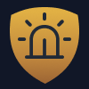

<p align="center"></p>

# homebridge-ecobee-security

Shows **ecobee Smart Security** in Apple Home as a security system: arm **Stay**, arm **Away**,
**disarm**, and **Alarm triggered** when ecobee has an open intrusion or smoke incident. It also adds
**air quality** sensors for ecobee thermostats that have one (ecobee Premium), which ecobee's own
HomeKit integration leaves out. Works with
Siri ("set the security system to away") and Home automations. ecobee removed Smart Security from
its HomeKit integration; this brings it back.

Unofficial. It uses the same cloud API as the ecobee iOS app (Auth0 sign-in at `auth.ecobee.com`,
GraphQL at `federated-api.prod.federated-graph.generacapis.com`), which ecobee can change at any time.
No dependencies.

> [!WARNING]
> Not affiliated with or endorsed by ecobee. The plugin signs in as the ecobee iOS app, which
> ecobee may not allow, and it can stop working whenever ecobee changes its app or API.
> If you have **professional monitoring**, testing an alarm (opening a door while armed) can
> lead to a call from the monitoring centre or a dispatch, just as it would with the ecobee app.

## Install

In the Homebridge UI, search the Plugins tab for **ecobee Smart Security**, or:

```
npm install -g homebridge-ecobee-security
```

Running it as a child bridge is recommended. Requires Node 22 or 24 and Homebridge 1.8 or 2.x.

## Sign-in

Open the plugin's **Settings** in the Homebridge UI and sign in with your ecobee email and password,
then the verification code if your account uses MFA. The plugin saves a refresh token in its config;
your password is sent only to ecobee and isn't stored. Restart the bridge afterwards.

The plugin renews its access token every 2 hours and keeps the current refresh token in
`<homebridge storage>/ecobee-security/state.json` (mode 600). A newly saved token always replaces the
stored one. You only need to sign in again if ecobee revokes the token (for example after a password
change or "sign out of all devices"); the log then says so and the accessory shows a fault.

**If sign-in fails** (for example ecobee asks for a CAPTCHA), the settings page also offers sign-in
on ecobee's website: you sign in in a desktop browser and paste the final redirect URL from its
developer tools.

**Without the Homebridge UI**, sign in from a terminal and paste the printed token into the config:

```
node <plugin folder>/bin/ecobee-login.js            # email, password, MFA code
node <plugin folder>/bin/ecobee-login.js --browser  # website sign-in
```

## Config

```json
{
  "platform": "EcobeeSecurityPlatform",
  "name": "Security System",
  "refreshToken": "…",
  "pollInterval": 10,
  "offerNight": false,
  "alarmTrigger": "incident",
  "smokeSensor": true,
  "allowHolds": false,
  "airQuality": true,
  "co2Alert": 1000,
  "_bridge": { "username": "…", "port": 51926, "name": "Ecobee Security Bridge" }
}
```

`homeId` is only needed if the account has several homes (the log lists them).

| Setting | Default | |
|---|---|---|
| `offerNight` | `false` | Adds Night to the Home app. ecobee has no Night mode, so Night arms Stay and the tile keeps showing Night until the state changes (a Stay armed elsewhere shows as Stay). HomeKit only picks up a changed list of modes on a new control, so changing this setting recreates the security system in the Home app: set up scenes and automations that use it again. |
| `alarmTrigger` | `"incident"` | When the tile enters **Triggered**: `"incident"` immediately, when ecobee opens an incident as a door or sensor trips while armed (mirrors the ecobee app); `"entryDelay"` only after the entry (disarm) delay runs out without a disarm. Smoke alarms always trigger immediately. |
| `smokeSensor` | `true` | Adds a separate **Smoke Alarm** accessory (a Smoke Sensor) that detects smoke while ecobee has a smoke-alarm incident open, for automations and Home app smoke notifications. Set to `false` to remove it. |
| `allowHolds` | `false` | Lets other Homebridge plugins ask for a **security hold** (see below), e.g. so a robot vacuum can clean while you're away without setting off the motion sensors. Off: hold requests are refused, and a hold left over from before is dropped without re-arming Away. |
| `airQuality` | `true` | For each thermostat with an air quality sensor: an accessory "&lt;thermostat&gt; Air Quality" with an **Air Quality Sensor** (overall level; VOC as ecobee reports it, in ppb, which the Home app labels µg/m³) and a **Carbon Dioxide Sensor** (ppm). Read every 5 minutes. The level follows the ecobee app's Clean–Poor bar: its first two segments are Excellent, then Good, Fair, Inferior, Poor; Unknown while the sensor calibrates. |
| `co2Alert` | `1000` | CO2 (ppm) at or above which the Carbon Dioxide Sensor reports abnormal levels. |

## How it behaves

- **Arm Away** uses ecobee's Away exit delay (60 s by default), just like the app. During the
  delay the Home app shows "Arming…" (current Disarmed, target Away). Stay uses the Stay exit delay
  (0 by default). Disarm needs no PIN.
- **Changes from elsewhere** (ecobee app, keypad, ecobee automations) show up within the poll
  interval (10 s by default), and quickly after an exit delay ends.
- **Alarm triggered** while ecobee lists an open incident (see `alarmTrigger` above for when it
  starts showing). Disarming clears it. Every change in the incident list is logged.
- **Siri:** the Home app calls Stay "Home". Asking Siri for Home or for Stay mode both arm Stay.
- **Night** is only offered with `offerNight`; ecobee has no Night mode of its own.
- After three failed reads in a row the accessory shows a fault; reads back off up to 5 minutes.
- **Security holds** for other plugins, with `allowHolds`: see below.

## Security holds

A security hold lets another Homebridge plugin, such as a robot vacuum, keep the motion sensors from
going off while it moves around the house when you're away. The plugin can only *ask*; this plugin
decides, by four rules:

1. **Hold:** if the system is armed Away (or arming Away), it's switched to Stay. If an alarm is in
   progress, or ecobee can't be read, the hold is refused. Otherwise nothing changes.
2. **Release:** once **every** plugin that asked is done, and the system is still in Stay, it's
   armed Away again (with the normal exit delay).
3. **Your change wins:** anything someone else does during a hold — disarm, arm Away, a change in
   the Home app, an alarm — cancels it, and the system is left as it is.
4. **No timers:** nothing changes unless a plugin asks or you act.

Every decision uses ecobee's state read at that moment, not the last poll. Holds are off until you
turn on **Allow security holds** in the settings' **Security holds** section and tick each plugin that
may ask (`holdPlugins`): it lists installed plugins that declare they use holds, and any plugin that
has asked. A plugin that isn't ticked is refused (it can still release a hold it already has).
Turning holds off drops a hold left over from before (without arming Away).

**Limits** that follow from these rules:

- **Your own Stay looks like the hold's Stay.** If you disarm and re-arm Stay in the ecobee app or at
  the keypad within a few seconds (between two reads), or while the bridge is restarting, the
  release still arms Away: ecobee doesn't say who last changed the state. Changes in the Home app are
  always seen.
- **Your change wins even with a robot still out.** After you cancel a hold (say, disarm), arming
  Away while the robot is still cleaning can set off the motion sensors: a plugin only asks for a
  hold when it starts.
- **Plugins identify themselves.** Any plugin running as the homebridge user can reach the socket,
  and the plugin name it gives is its own claim: the list keeps honest plugins apart, it isn't a
  lock. Two requests with the same name share one hold.
- **A plugin that never releases leaves the system in Stay** until you change it.

**API** (for plugin authors): a Unix socket at `<homebridge storage>/ecobee-security/control.sock`
(mode 600, homebridge user only), declared in `package.json` as
`"homebridge-security-hold": { "socket": "ecobee-security/control.sock" }` so plugins that support
holds, like homebridge-narwal-freo, can list it. Plugins that ask for holds can declare
`"homebridge-security-hold": { "client": true }` to show up in the list before their first request.
The full API: [Security hold](https://github.com/seanfletchr/homebridge-narwal-freo/blob/main/docs/security-hold.md).

- `POST /hold?by=<name>&plugin=<package>` → `{ "ok": true, "held": true|false, "state": "…" }`,
  or `"ok": false` with a `"reason"`: don't start. `plugin` is optional; without it the plugin is
  listed (and allowed) under its `by` name.
- `POST /release?by=<name>&plugin=<package>` → `{ "released": true|false, "state": "…", "waiting": [names] }`;
  `waiting` lists holders still out.
- With `allowHolds` off or the plugin not ticked, both answer 403 (a release from a current holder
  is always accepted); if ecobee can't be read (release) or isn't connected
  yet, a 5xx with `"error"` — try again later. Holds survive restarts (in `state.json`).

## API notes

[docs/api.md](docs/api.md) describes the sign-in flow and GraphQL calls the plugin uses, for anyone
fixing it after an ecobee change or adding features.

## License

MIT
